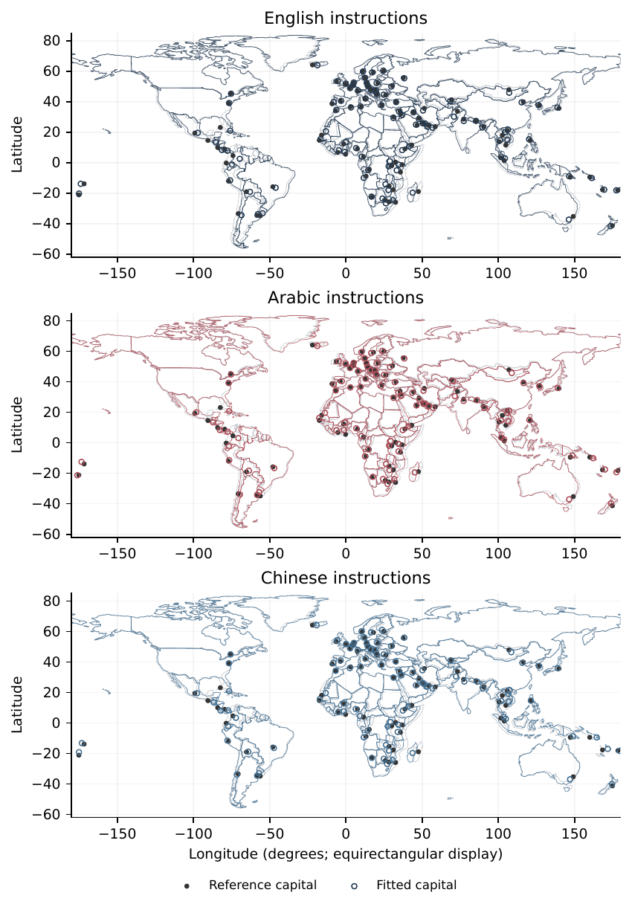

Ask a language model how far apart two cities are and you get a plausible number. Ask it about every pair among 100 capitals and you can test whether those numbers fit together into a coherent globe. Cognitive Atlas runs that check and maps what comes back.

## The study

Gemini 3.5 Flash estimated the distance between every pair of 100 world capitals, ten times per pair, prompted separately in English, Arabic and Chinese: 148,500 estimates in total.

Pair by pair, the numbers are strong. Median estimates miss the true distance by 216 to 234 km on average, and the distance rankings are nearly exact (Spearman correlation above 0.998). Taken together, though, they don't describe a valid geometry: between 10.7% and 13.3% of city triples violate the triangle inequality, putting the direct route from A to C further apart than going via B.

## The maps

Projecting the distance matrix onto a sphere lands capitals within 150 to 158 km of their true locations on average, while switching the prompt language shifts the reconstructed map by 81 to 88 km per city. I expected prompts in Arabic to place Arab capitals more accurately, and Chinese prompts to do the same around Beijing; neither showed up.

The live site lets you inspect the distortions directly, with warped coastlines, displacement vectors, error overlays and a pair inspector. The paper covers the caveats: a single model, one translation per language and one sampling window.
