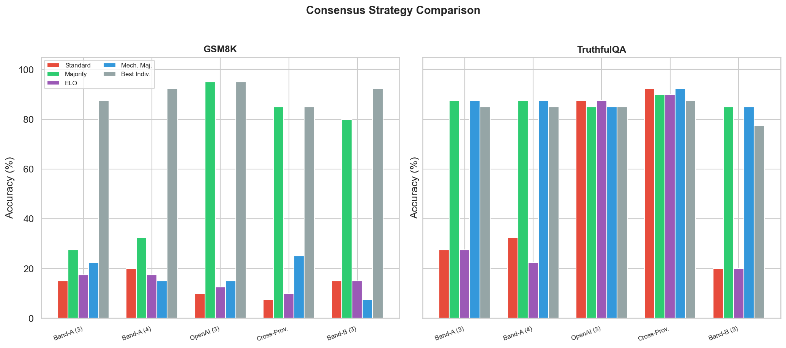

When an answer matters, I usually paste the same question into two or three models and compare notes. Ensemble turns that habit into one step: pick the models, send a prompt, and read their answers side by side alongside an agreement score and a merged response. Low agreement is often the most useful signal, flagging questions where no single model should be trusted.

## The app

The flow runs through four screens: choose a mode and add API keys, select models, write the prompt, and review. In Free mode your browser calls OpenAI, Anthropic, Google and xAI directly with your own keys, then embeds every response to score pairwise agreement.

There are several ways to combine the answers, each in its own package:

- **Standard**: one model reads all the responses and writes a single answer.
- **Majority**: a model-assisted majority vote.
- **ELO**: responses are compared in pairs and ranked.
- **Council**: each model critiques every other model's answer, responds to the critiques of its own, then votes on the result.

The codebase is a Next.js monorepo backed by 39 Storybook components, designed and tested from wireframes before any backend work began.

## Do ensembles actually help?

I wanted to check whether a deliberately chosen mix of models actually beats its strongest member. Across four stages, I ran 20 models on 20 questions each from three benchmarks, grouped them by accuracy, measured how rarely each pair erred on the same item, and then tested five ensembles on 40 questions per dataset under every combining strategy.

On TruthfulQA every ensemble beat its best member, by 2.5 to 7.5 points. The cross-provider ensemble, one model each from OpenAI, Anthropic, Google and xAI, reached 92.5%, which was every question that at least one member got right.

On GSM8K maths problems, every ensemble lost to its best single model. Signal wasn't the problem: at least one member solved 97.5% to 100% of the questions. The combiner threw the right answers away. Having a language model write a prose synthesis broke the numeric answer parser, dropping scores to between 7.5% and 20%. Plain majority voting held up best, and counting extracted answers in code matched model-assisted voting on TruthfulQA.

## Caveats

With 40 questions per benchmark, confidence intervals span more than 14 percentage points, so treat these as pilot signals to re-run at 200+ items rather than settled results. Two patterns were steady enough that I rely on them anyway: simple majority voting is at least as reliable as model-written synthesis without mangling numeric tasks, and mixing providers surfaces the right answer almost every time. The hard part is picking it out cleanly.
