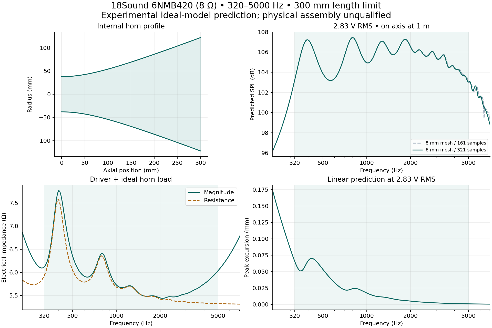
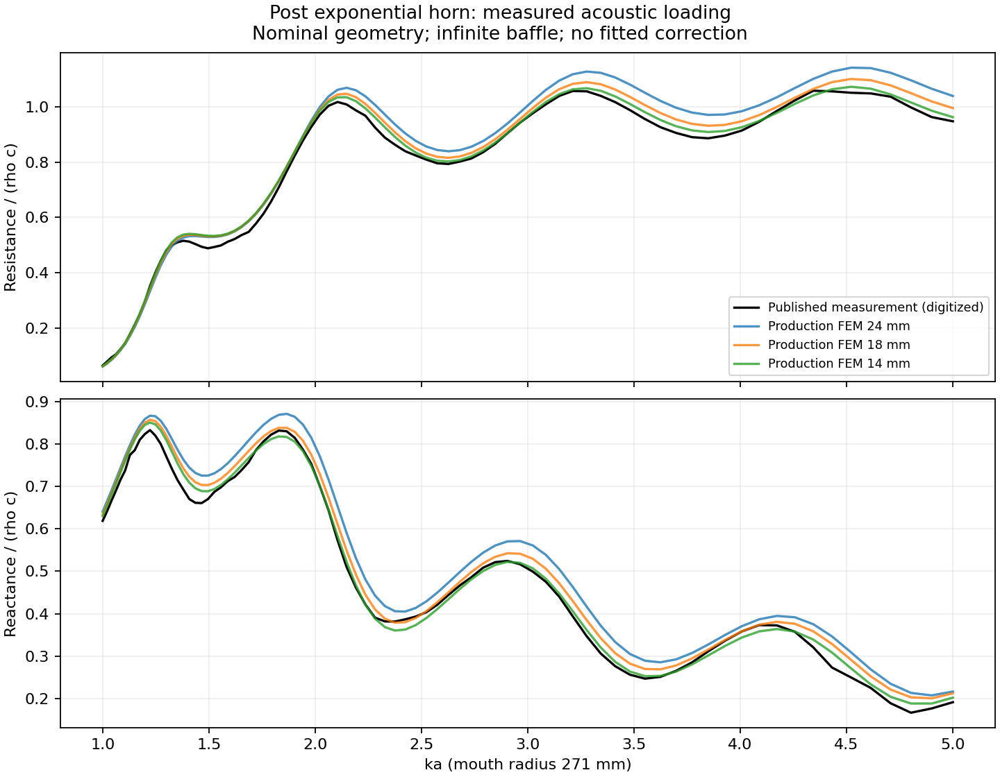
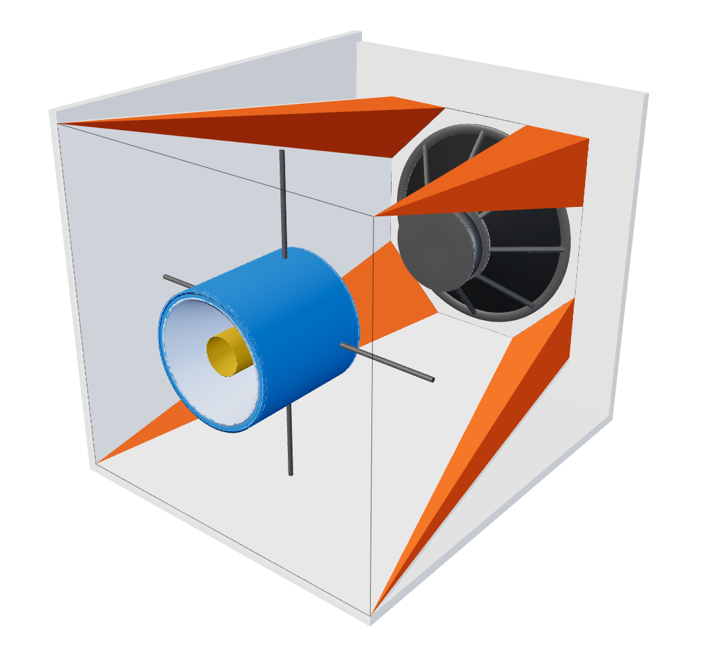

Designing a horn loudspeaker usually means picking a flare formula, guessing dimensions, running a simulation and iterating by hand. I wanted to start from the question you actually care about ("which driver and horn profile cover 320 to 5000 Hz inside 300 mm of depth?") and get back a ranked shortlist with printable CAD.

Give Horn Simulation a target passband and size box, and it generates candidate profiles, solves the Helmholtz equation on each with finite elements, couples the acoustic impedance to catalogue drivers via their Thiele-Small parameters, and ranks every pairing. Each run outputs a standalone HTML report alongside the winning STEP geometry.

## How it works

The search covers seven profile families: conical, exponential, hyperbolic, tractrix, oblate spheroid (OS), Le Cléac'h and constant directivity. Mouth size and length are first derived from the band analytically, which narrows a grid of hundreds of candidates down to a shortlist. Only the shortlist gets full FEM solves, using FEniCSx with a modal radiation boundary at the mouth. A small refinement budget then adjusts the most promising dimensions.

Geometry is built with gmsh and exported as STEP. Frequency bands are solved in parallel in Docker containers orchestrated by Nextflow, and every run writes a manifest of its source, inputs and container hashes so a result can be traced back to exactly what produced it.

## A worked example

The repository includes a finished design for the 8-ohm 18Sound 6NMB420, a 6.5-inch midrange, covering 320 to 5000 Hz with a 300 mm length limit. The search picked an OS horn with a 76 mm throat and a 245 mm mouth. The predicted response varies by 4.4 dB across the band and averages 105.5 dB SPL at 2.83 V and 1 m, without EQ.

Reaching that design took two passes. A wide 700-geometry sweep sent eight finalists to full FEM and every one exceeded the ripple target; narrowing the search around a smaller throat turned up the OS family that passed. Across both passes, 15 geometries ran through full FEM sweeps, and mesh plus frequency-grid refinement shifted the in-band curve by at most 0.24 dB.

## Checking it against a real horn

A solver that only agrees with itself proves very little, so the pipeline checks itself against published hardware data. Using the fibreglass exponential horn measured in John Post's 1994 thesis, I generated the nominal profile, solved it across three mesh densities, and compared the curves directly against his digitised impedance plots with no parameter fitting. Pass thresholds were locked before running.

The finest mesh is within 0.5 dB and 1.9 degrees of the measurement over the compared range, roughly 200 to 1000 Hz. That validates the horn loading model. It does not validate a complete driver and horn assembly: the driver interface, real adapters and listening-distance predictions still need physical measurements, and the README says so.

## What's next

The same approach is now feeding a larger design: a three-way coaxial horn with a reversed 15-inch driver for the low end, a 6.5-inch mid horn mounted in its mouth, and a tweeter housing at the centre. The mid horn comes from a completed simulation run; the surrounding cabinet is still just a layout study, using corner inserts to transition from a square throat to an octagon, and the combined three-way hasn't been solved as a coupled system yet.

Horns fed by several drivers at once are out of scope here. They live in a sister project, [MEH Design Studio](/meh-design-studio/).
