Evolution has had a long time to solve coordination problems at the scale of molecules, cells, organisms and populations. I wanted to know which of those solutions are useful when designing software, so I built a catalogue.

## The patterns

Eight patterns are written up so far, including:

- **Bounded compartments**, from cellular compartmentalisation: contain overload so billing keeps working while analytics rejects work.
- **Bow-tie core**, from metabolism: many inputs and outputs meet at a small shared core, which cuts down pairwise integrations.
- **Integral feedback**, from cellular signalling: keep a service at a utilisation target as demand changes.
- **Persistence filter**, from a common gene-regulation motif: ignore short spikes and act only on sustained signals.
- **Quorum signalling**, from bacteria: coordinate optional activity based on local participation.

Each entry has the biological basis with citations, a mapping table, an architecture diagram, implementation notes, failure modes, where the analogy breaks down, and an experiment to try.

Here is the bow-tie pattern, where many input formats meet a small shared core before fanning out to consumers:



And quorum signalling, where a decaying shared signal decides whether workers join in:



## Keeping it honest

Each entry separates three layers that are easy to blur: empirical findings in biology, evolutionary explanations for them, and the software engineering hypothesis they suggest. A neat biological parallel is an excuse to run a benchmark, not evidence that an architecture works. Every write-up also spells out what production use would still require; the quorum-signalling script, for instance, coordinates optional background work rather than implementing fault-tolerant consensus.

The examples use only the Python standard library and need no setup:

```sh
git clone https://github.com/timini/nature-inspired-architectures.git
cd nature-inspired-architectures
python3 -m natural_architectures all
```
