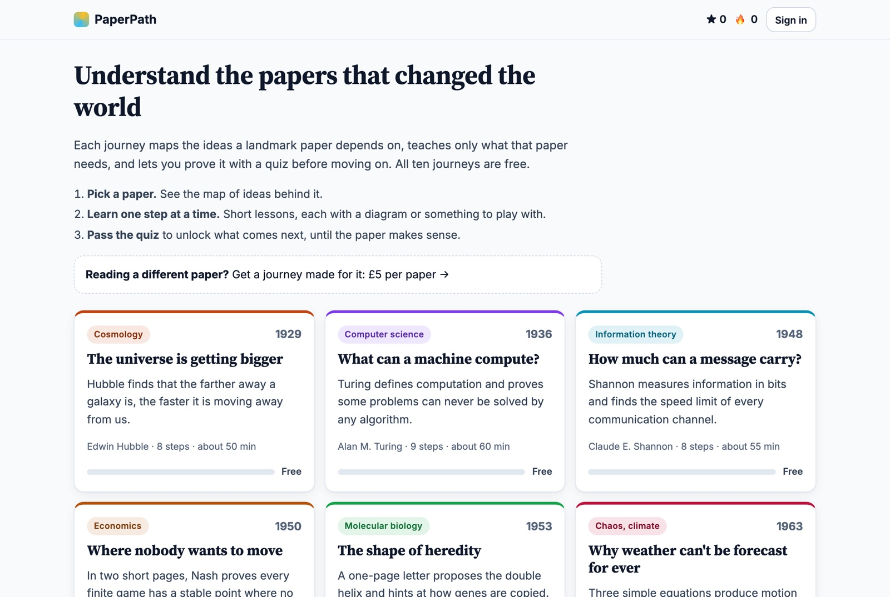

Reading a classic paper from outside its field usually stalls in the same place: page two assumes five concepts you haven't met, each of those leans on three more, and textbooks teach the entire subject when you only need one slice of it. PaperPath works backwards from the target paper instead.

## How it works

Each journey is a dependency graph for one paper. For *Attention Is All You Need*, the path starts with word vectors and sequential reading, steps through scaled dot-product attention, multi-head self-attention and positional encoding, climbs into the encoder-decoder stack, and finishes with the paper itself.

Every step is short, teaches the idea only as far as the paper needs it, and has a visual: either an animated step-through diagram or something to play with, such as a payoff matrix for finding a Nash equilibrium. Each step ends with a quiz. Passing it unlocks the steps that build on it, so you cannot reach the paper with a gap in the middle.

## What's live

Ten journeys, all free and with no account needed:

- Hubble on the expanding universe (1929)
- Turing on computability (1936)
- Shannon on information (1948)
- Nash on equilibria (1950)
- Watson and Crick on DNA (1953)
- Lorenz on chaos (1963)
- Diffie and Hellman on public-key cryptography (1976)
- Backpropagation (1986)
- The Transformer (2017)
- AlphaFold (2021)

Together that is 83 steps and 269 quiz questions. There are 57 animated diagrams and 26 interactives built from a library of 18 widgets. Progress is kept in the browser, and signing in with Google keeps it across devices.

## How it's built

The app is React and TypeScript on Firebase. Journeys are declarative data rather than custom code: each one conforms to a strict schema, and build-time checks validate the prerequisite graph, every quiz item and every widget parameter. Numeric quiz answers are recomputed independently in the test suite so a stale answer key breaks the build, and interactive steps can only instantiate components from a vetted widget library.

Keeping journeys strictly data-driven prepares for the next phase: generating new paper guides automatically with an agent built on the Claude Agent SDK, and holding generated paths to the exact same validation checks as hand-written ones.

## What's next

On-demand journeys for a paper of your choice are priced at £5. The site records requests already; automated generation and Stripe checkout are the next two pieces to build.
