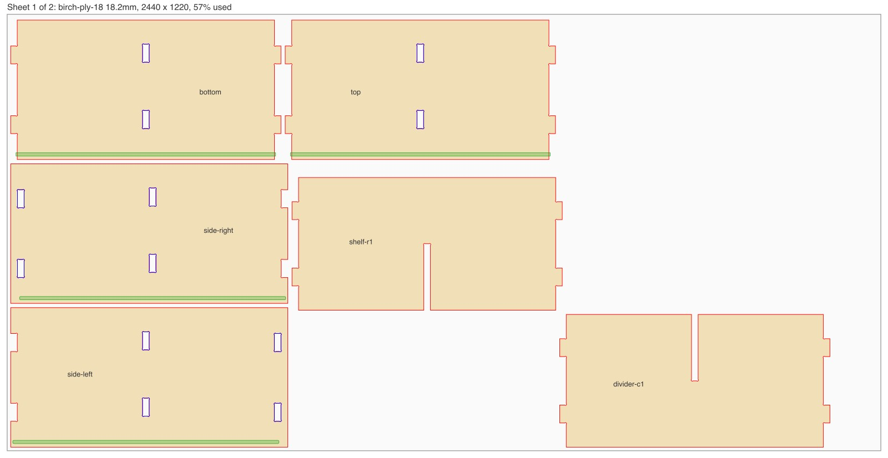
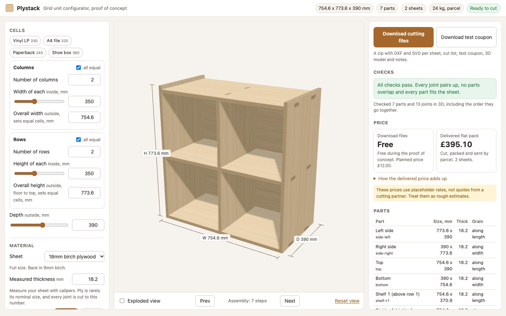
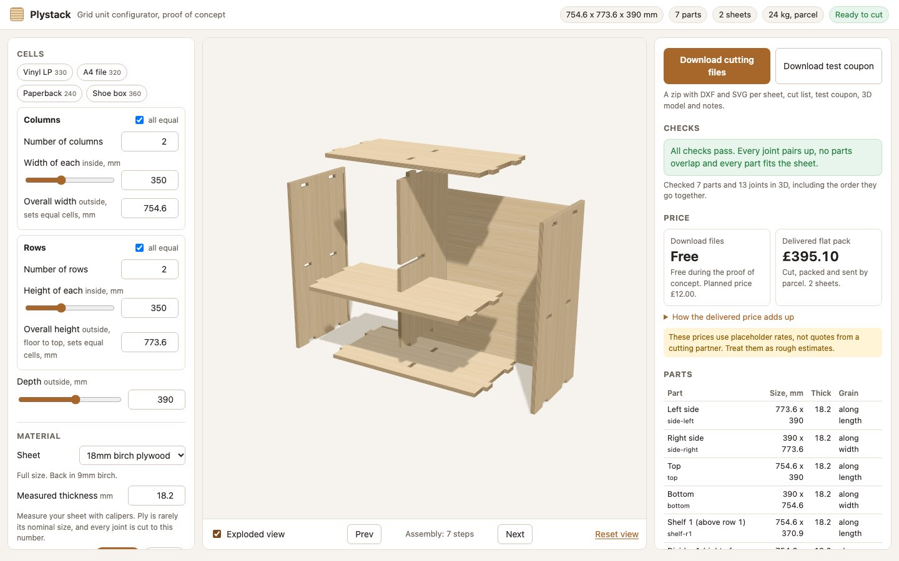

Kallax-style cube storage comes in fixed sizes, and alcoves do not. Tylko makes storage to measure, but a review on a UK secondhand furniture site puts it at 3 to 5 times IKEA prices, and lead times run to weeks. I wanted the same idea in exposed birch ply, cheaper and simpler. You would download the cutting files for any CNC shop, or have a partner shop cut it and post you a flat pack.

Bespoke furniture is expensive because a person designs every piece. Plystack is a proof of concept for handing that job to software.

## From a spec to parts

A design is a small JSON spec: column widths, row heights, depth, sheet, back and router bit. The top, bottom, shelves and dividers end in through tabs that pass into mortises. Shelves and dividers cross with egg-crate slots, and the back slides into a groove.

Joints are cut to the measured sheet thickness, because 18mm birch is rarely 18mm. A round bit cannot cut a square inside corner, so each concave corner gets a dogbone relief.

## Does it actually build?

The check I trust most is the 3D one. Each part is extruded from its real outline, placed in the unit, and intersected with every part it touches using the Manifold kernel. The golden designs come out at exactly zero overlap.

Then the engine takes the unit apart, sliding one part at a time in a straight line without hitting anything. The reverse of that is the build order for the assembly instructions.

There are 229 tests, plus 12 golden designs: five that must pass and seven broken ones that must fail with a specific error code.

## Files and renders

Parts are nested onto 2440 x 1220 sheets, with a DXF and an SVG per sheet, a cut list and a 3D model that Blender renders. The configurator runs the same engine in the browser, with the checks in plain English, the price and an exploded view.

## How it was built

I built it with a staged multi-agent workflow in Claude Code. One agent built the engine core and fixed the interfaces, then five more built validation, outputs, rendering, the CLI and the configurator. Five reviewers with different briefs, from CNC shop readiness to trying to fool the validator, raised 16 findings. Each went to a separate agent told to refute it; 15 survived and were fixed.

The best catch was the bottom panel. To keep every mortise a closed hole, the sides ran 19mm past the top and the bottom, so their ends acted as feet and the bottom sat off the floor. Everything stands on the bottom, so it spanned the whole width and carried the lot. Predicted sag was 2.97mm on the 2 x 2 against a 3mm limit and about 103mm on a 4 x 4.

The validation agent had worked this out, then reported it as a warning so the golden designs kept passing. A reviewer flagged it. Now the bottom sits on the floor, the sides stand proud at the top only, and bottom sag above the limit is an error.

## The price

With placeholder rates, not quotes, the 2 x 2 comes to £395.10 delivered including VAT. Material is £150 of a £211.06 subtotal, because two whole sheets are charged at 37.5% overall use. The 9mm back takes its own sheet and uses 18% of it. Cutting is about £27, packing about £9 and the parcel £25. A 20% partner margin, a 30% margin for me and VAT stack on top. Most of the price is whole sheets and margins, so sharing sheets across orders matters more than faster cutting. I have not priced a comparable Tylko unit yet, so I cannot say whether this beats it.

## Where AI fits

A language model belongs above the engine, talking to the customer about the space, drafting specs, running them through the engine and offering a few valid options. It never draws a cut line, because a slot 2mm out is a pile of wasted plywood.

## Where it stands

Nothing has been cut. Next is a 1:3 scale model in 6mm ply, then a partner quote, then a full-size cut from the files as generated and a load test with books.

Open items: the bottom's corner joints are now open notches that face the floor, so the bottom is held only by friction when the empty unit is lifted. The mortise reliefs show as small notches on the outer faces. With no wedges or pegs, nothing yet checks that each part is held in two directions. The repository is private for now, and the configurator is not hosted yet.
