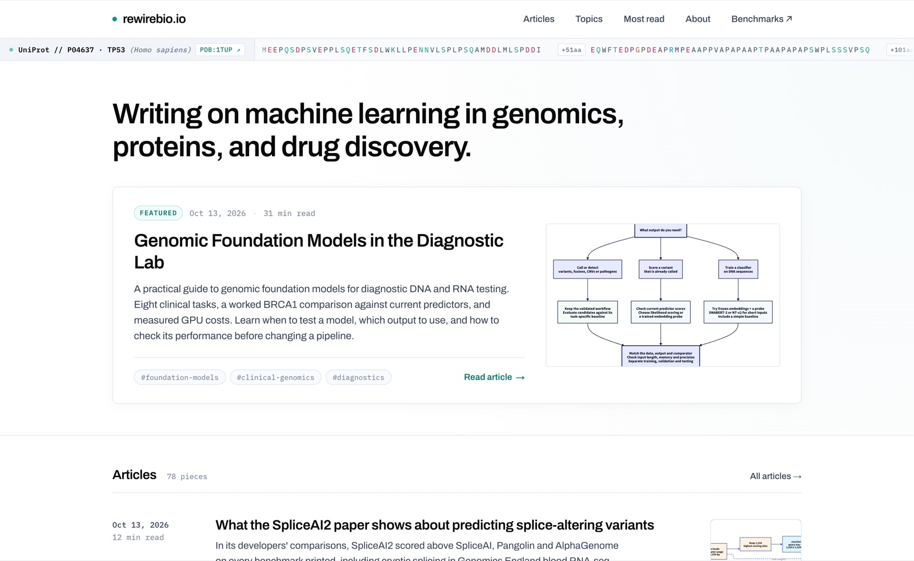

Picking a machine learning model for a biology task is harder than it should be. Results are spread across papers, preprints and benchmark suites. Each uses its own datasets, splits and metrics, so numbers from two papers often cannot be compared, and new models appear faster than anyone can read about them.

Rewire Bio tackles that across a structured benchmark database, reproducible open baselines and critical paper reviews.

## The benchmark database

[benchmarks.rewirebio.io](https://benchmarks.rewirebio.io/) collects published and reproduced results and organises them around 28 use cases, so you start from the biological question rather than a model name. Every value links to the paper, table or run it came from. Results measured under different protocols are kept apart instead of being merged into one ranking, and where the evidence for a use case is thin, the page says so.

The underlying records live in a public repository with immutable releases and a written protocol for finding, extracting and independently checking every figure. AI agents can query the graph directly through an MCP server.

## Open benchmarks

Where published results leave a gap that matters, I run the benchmark myself. The rule for [rewire-benchmarks](https://github.com/rewire-bio/rewire-benchmarks) is that every run uses public data and open weights on hardware a reader can afford, and reports what it cost as well as what it scored. The aim is not to rank models but to give a baseline anyone can re-run.

Some of these become standalone studies. [evo2-cloud-operations](https://github.com/rewire-bio/evo2-cloud-operations) runs one pinned Evo 2 7B container on Google Cloud and Runpod GPUs and records cost, GPU memory and whether the outputs agree across hardware. A clean reproduction on fresh machines matched the original run.

When I find a mistake, the correction is published next to the original. The MFASS splicing baseline, for example, used a reverse-complemented sequence for 7,770 variants; the v1 results are kept for audit and marked as superseded.

## Articles

[rewirebio.io](https://rewirebio.io/) has 78 articles on machine learning in genomics, proteins and drug discovery. Most look at what a paper actually shows, separating developer-reported numbers from independent ones. The featured piece is a practical guide to genomic foundation models in diagnostic labs, with a worked BRCA1 comparison and measured GPU costs.

## Tools for agents

Two standalone MCP servers grew out of the platform. [genomics-mcp](/genomics-mcp/) lets an AI assistant discover public genomic datasets, read bounded slices of remote or local files, and look up variants and genes while tracking the provenance of every value. [rdf-kg-mcp](https://github.com/rewire-bio/rdf-kg-mcp) exposes a versioned RDF knowledge graph read-only, which is how agents query the benchmark database.
