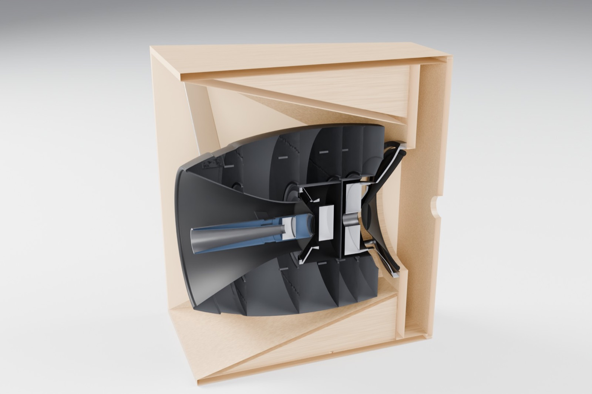
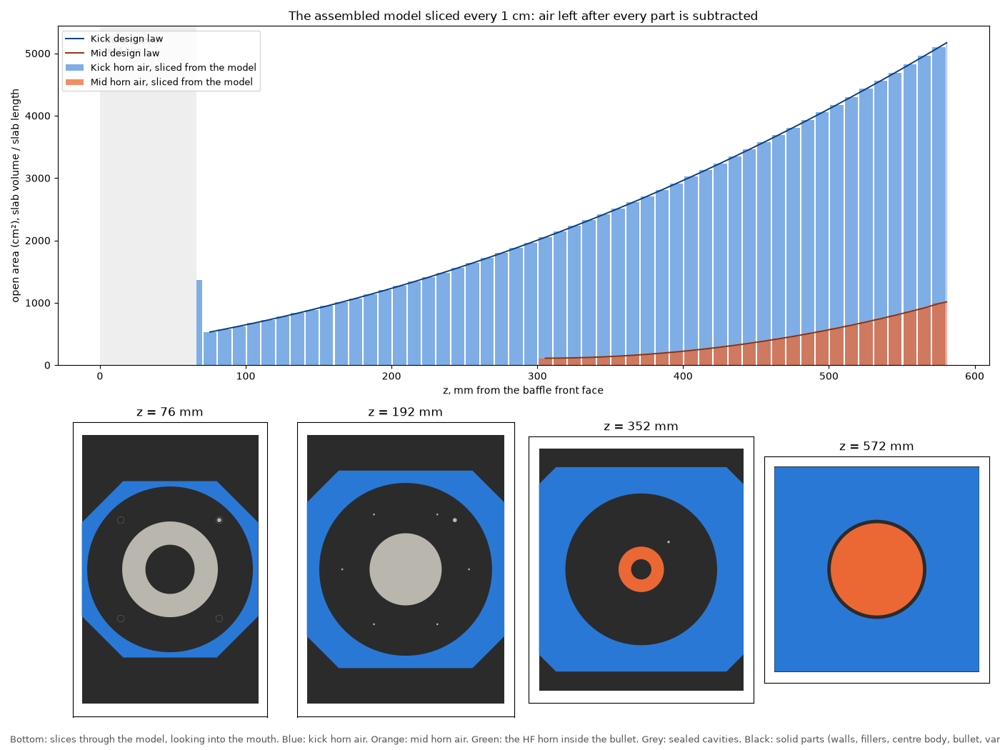
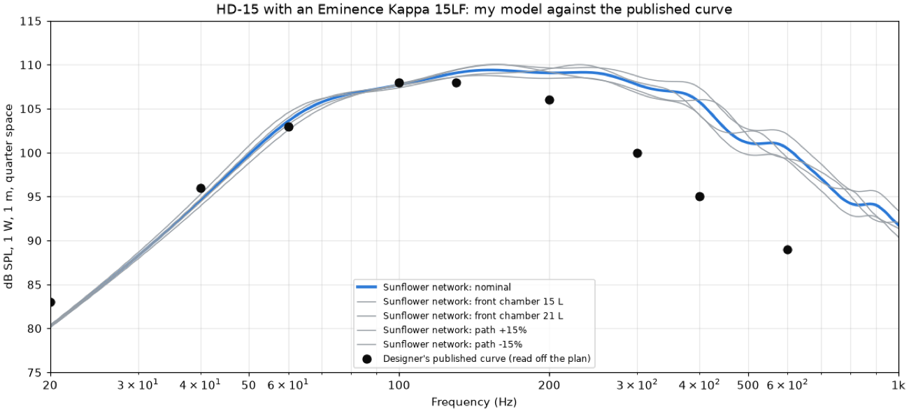

The [Horn Simulation](/horn-simulation/) post ended with a sketch of a three-way coaxial horn. Sunflower is that idea taken all the way to CAD: a reversed 15 inch kick horn, an 8 inch mid horn in its centre body, and a 1 inch compression driver whose printed horn is the mid's phase plug. Each horn's phase plug is the next horn in.

The reference is the Funktion-One Res 2. Its point is a horn-loaded cone mid that carries the voice from 250 Hz up, so the 2 to 4 kHz consonant band stays on paper rather than on a compression driver. Sunflower keeps that split and puts all three sections on one axis.

## Inside out

Everything is sized from the centre outward. The HF unit's body sets the bullet-shaped mid phase plug; the plug and the mid cone set the mid throat; the mid horn and its sealed pod set the kick's centre body; and the body and the cabinet walls set the kick horn. Every inner body is subtracted from its horn's open area, and every horn follows an area law from throat to mouth.

The cabinet is single-ply birch. The sides are angled and the top and bottom are flat, with sealed wedges inside them, so the horn itself is a square frustum with a completely square mouth. That shape matters for arrays: nine identical boxes tile exactly as three fanned columns of three, with every joint flush.

## Sizing the phase plugs from the model itself

The first versions solved the phase plugs from equations, and the equations quietly ignored support vanes, corner fillers, basket arms and cable holes. Now the assembled CAD model, the same meshes the renders use, is cut every centimetre. At each cut the air left inside the walls after subtracting every part is measured, the plug is resized so that air equals the area law, and the model is rebuilt and sliced again. Two passes bring the kick within 0.2% and the mid within 0.8% of their laws at every slab. Slicing also showed the real basket arms block about 2% of the cone channel, not the 12% I had assumed.

## Checking the models

A long run of redesigns taught me that a model which only agrees with itself proves very little, so the acoustics are checked three ways.

- A known box. The HD-15, Rog Mogale's published 15 inch bass bin, modelled the same way, matches its published curve within about 1.5 dB from 40 to 130 Hz. Above 200 Hz the model reads high, most likely because its front chamber is lumped as a single volume.
- An independent solver. The real air volumes of both horns, exported as STEP and solved in Horn Simulation's 3D FEM, give the same throat impedance within a median 4% for the mid and 8% for the kick.
- FEM with the cones moving. With the reversed kick cone as a vibrating boundary, the FEM agrees with the plane-wave network within 0.6 dB RMS up to 250 Hz.

The FEM also found the most important limit. The air between the mid cone and its phase plug behaves as a cavity that a plane-wave model cannot see, and the cone stops radiating efficiently above about 3.5 kHz on an 8 inch. The plane-wave model had overstated the mid's top end by up to 5 kHz, which had led the optimiser to pick a 12 inch mid that the FEM puts at under 2 kHz. Slots in the plug, a slimmer bullet and felt under the nose did not move the limit; the depth of the cone sets it. So mids are now ranked on FEM, and the upper crossover is 3.5 kHz with an 18 Sound 15W700 kick, a Beyma 8MI100 mid and a B&C DE111.

## Where it stands

It is a simulated prototype. Nothing has been built or measured, and the driver cone and basket shapes come from datasheet drawings, so the shroud and the bullet need checking against real drivers before printing. The site has the full drawings, cut list, printable parts, responses and every validation plot.
